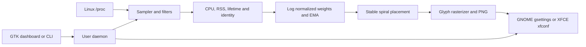

# ProcScape

ProcScape turns the processes visible to the current Linux user into a colorful, periodically refreshed word-cloud wallpaper. It is a native Rust application: process data comes from `/proc`, text is rasterized to PNG, and the GUI is an optional GTK 4 application.

## Status

This repository contains the sampler, weight calculation, deterministic themes, spiral placement and PNG renderer, GNOME/XFCE wallpaper integration, CLI/daemon, systemd user unit, and GTK dashboard with live metrics and process/appearance controls. The CLI and full non-GUI pipeline build and pass tests in Kali WSL. A real-process wallpaper was generated there and is shown below. WSL does not expose GNOME/XFCE wallpaper settings, and its GTK development libraries are not installed, so the GTK binary and desktop application remain unverified in this environment. Fedora GNOME is the intended desktop target for the installation steps below; a Fedora desktop run is still needed to verify GUI compilation and wallpaper application.

The reference image is the intended visual direction: varied type sizes, sparse vertical words, dense composition, and colorful text on a dark background. ProcScape uses real process names and resource values only. The WSL session exposed just 17 eligible processes, so this genuine sample is less dense than the supplied desktop reference.


## Build on Debian 13

Install Rust stable, a C toolchain, and GTK development files for the optional GUI:

```sh
sudo apt install build-essential pkg-config libgtk-4-dev fonts-dejavu-core
cargo build --release
cargo build --release --features gui --bin procscape-gui
```

The CLI build does not require GTK. For a first snapshot:

```sh
./target/release/procscape snapshot --output /tmp/procscape.png
```

## Install on Fedora Workstation with GNOME

Install the compiler, GTK 4 development files, pkg-config compatibility, and the default font:

```sh
sudo dnf install cargo rust gcc pkgconf-pkg-config gtk4-devel dejavu-sans-fonts
```

Build and run the GTK app from the project directory:

```sh
cargo build --release --bin procscape
cargo build --release --features gui --bin procscape-gui
cargo run --release --features gui --bin procscape-gui
```

To install the CLI, dashboard launcher, and user service into your home directory:

```sh
sh packaging/install.sh
systemctl --user enable --now procscape.service
```

Open **ProcScape** from the application grid, or run `procscape start`. The background service updates the GNOME wallpaper every 15 seconds by default. Use `procscape pause`, `procscape resume`, `procscape refresh`, and `procscape restore` to control updates and restore the wallpaper that was active before ProcScape. The service uses GNOME's wallpaper settings and does not create an always-on-top desktop window, including on Wayland.

To build just the CLI, omit `--features gui`; GTK development libraries are only needed for the dashboard. Fedora package names are listed by Fedora's package catalog for [`gtk4-devel`](https://packages.fedoraproject.org/pkgs/gtk4/gtk4-devel/), [`pkgconf-pkg-config`](https://packages.fedoraproject.org/pkgs/pkgconf/pkgconf-pkg-config/), and [`dejavu-sans-fonts`](https://packages.fedoraproject.org/pkgs/dejavu-fonts/dejavu-sans-fonts/).

The wallpaper image and state are stored under `$XDG_DATA_HOME/procscape` (normally `~/.local/share/procscape`). A one-off snapshot defaults to `wallpaper.png`; the daemon uses uniquely named images and retains the latest three so GNOME sees a changed URI and can load it before older files are cleaned up. Configuration is created at `$XDG_CONFIG_HOME/procscape/config.toml` (normally `~/.config/procscape/config.toml`). Run `procscape config` to create it and print its path.

## Run

```sh
procscape snapshot --output ~/Pictures/procscape.png
procscape start
procscape status
procscape pause
procscape resume
procscape refresh
procscape stop
procscape restore
procscape metrics
```

`snapshot` samples twice 180 ms apart so CPU sizing is meaningful even when the daemon is not running. `start` launches the user daemon, which writes and applies a fresh wallpaper every 15 seconds by default. `stop` stops the service and leaves the generated wallpaper active. `restore` restores the wallpaper values recorded before ProcScape first applied its image. The original settings snapshot remains in the data directory for inspection.

To use the GTK dashboard, build with `--features gui --bin procscape-gui` and run `procscape-gui`. The dashboard can start/pause the daemon, request a refresh, restore the prior wallpaper, and save a small set of appearance controls. Closing the window does not stop the daemon.

The install helper runs `cargo install --path . --features gui`, installs the desktop launcher, and writes a systemd user service. This GUI installation requires the GTK 4 development libraries above. Enable it at login with:

```sh
systemctl --user enable --now procscape.service
```

The service uses the same daemon as `procscape start`; don't run both at once. See `packaging/uninstall.sh` to remove the binaries and launchers. It leaves saved settings and wallpaper files in place.

## What it does



Process CPU is calculated from process tick deltas divided by aggregate CPU tick deltas, multiplied by online CPU count. That presents single-core-equivalent percent, so one busy process can exceed 100% on a multicore machine. Overall CPU and memory percentages are system-wide. RSS is read from `/proc/<pid>/stat` and converted using the runtime page size. The sampler works as an unprivileged user; inaccessible or exited processes are skipped.

Names are grouped by default. Set `group_by_name = false` for per-PID entries. The normalized CPU and memory scores are logarithmic and smoothed in daemon memory. The renderer sorts by score, gives larger words more area, keeps deterministic colors, and persists normalized positions between refreshes. Rectangular text bounds are reserved on a coarse spatial grid; this is conservative around glyph whitespace and avoids text-on-text overlap. Extremely long names or dense process sets may be omitted when no legal placement fits; names are not clipped or shrunk below the configured minimum.

Themes: `catppuccin-mocha`, `catppuccin-latte`, `terminal-green`, `cyberpunk`, `monochrome`, and `custom`. See `configs/config.example.toml` for all supported settings. Use `width` and `height` to force image dimensions; zero asks the renderer to detect a display through `xrandr`, then falls back to 1920×1080.

## Desktop integration and limits

GNOME is updated through its supported GSettings background keys (`picture-uri` and `picture-uri-dark`). This is a periodic snapshot approach, not a live desktop surface or GNOME Shell extension. Wayland is supported through wallpaper settings only; ProcScape does not create a desktop window. On X11, `xrandr` geometry can be used to render one wallpaper spanning the detected monitors; separate per-monitor images are not generated. XFCE uses the standard `xfconf-query` background property for the first monitor/workspace. Other desktop environments are not currently supported.

Wallpaper restoration captures GNOME's light/dark URI or the first XFCE workspace image before the first replacement. ProcScape changes the URI to a persistent versioned file in its data directory, avoiding same-path image cache issues. GNOME visual behavior and how each desktop applies multi-monitor settings still needs verification on the user's session.

The GTK dashboard provides live process/CPU/memory summaries, a top-process list, service controls, theme/mode/interval selection, sizing and smoothing controls, process-name search/exclusions/pinning, user-only and process-group filters, thresholds, font/colors, and output dimensions. GNOME spanning uses detected XRandR monitor geometry and `picture-options=spanned`; this still needs verification on actual GNOME X11/Wayland sessions. XFCE currently targets the first monitor/workspace. Live compositor rendering, performance presets, historical statistics, and separate per-monitor images are not implemented. CPU smoothing state is held in daemon memory and starts fresh after a daemon restart.

## Development and checks

```sh
cargo test
cargo run -- snapshot --output /tmp/procscape.png
```

Unit tests cover config round-trip, CPU delta math, `/proc/stat` name parsing, process-name selection, filtering, duplicate grouping, weight ordering, stable colors, CLI parsing, monitor geometry, layout bounds/collisions, 300 equal-size words, and very long names. Integration tests exercise a live `/proc` to PNG pipeline and daemon start/pause/resume/stop. In Kali WSL, `cargo test` passed all 29 unit and integration tests, and the release `procscape snapshot` rendered a valid 1920×1080 PNG from 17 observed processes (16 placed, 1 too large for the configured bounds). On one measured WSL run, PNG rendering took 32 ms; the complete snapshot command took 267 ms wall time, used 35 ms child CPU time, and peaked at 13,284 KiB RSS. These are WSL measurements, not a Fedora GNOME system benchmark. The GTK build stopped because GTK development `.pc` metadata/pkg-config is unavailable. Installing those dependencies would upgrade 19 packages and add 258, so I left the distro unchanged. Desktop wallpaper application could not be verified from WSL.

Implementation references: [`sysinfo` crate documentation](https://docs.rs/sysinfo/latest/sysinfo/) was reviewed as a process-monitoring option; the implementation uses `/proc` directly to keep sampling small and transparent. Text uses [`ab_glyph`](https://docs.rs/ab_glyph/latest/ab_glyph/). GNOME background keys are documented in the [GNOME desktop background guide](https://help.gnome.org/system-admin-guide/desktop-background.html).

## License

MIT. See [LICENSE](LICENSE).
