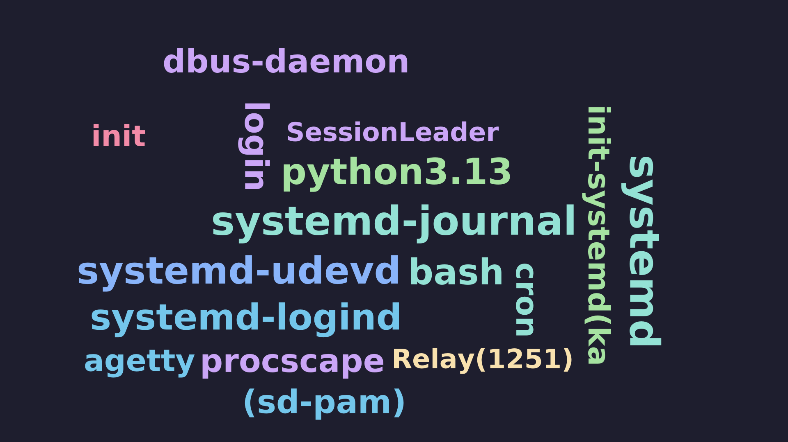
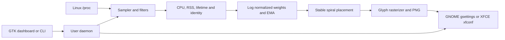

# ProcScape

ProcScape turns the processes visible to the current Linux user into a colorful, periodically refreshed word-cloud wallpaper. It is a native Rust application: process data comes from `/proc`, text is rasterized to PNG, and the GUI is an optional GTK 4 application.



## Downloadable installers

Release packages support **Fedora 44 x86_64** and **Debian 13 x86_64**. Download the matching package from [GitHub Releases](https://github.com/violatedheart/procscape/releases), then install it from your Downloads folder:

```sh
# Fedora
sudo dnf install ./procscape_*_fedora44_x86_64.rpm

# Debian 13
sudo apt install ./procscape_*_debian13_x86_64.deb
```

Open **ProcScape** from your application menu and choose **Start / resume**. Enable **Start on login** in the app's settings if you want automatic startup. Packages install the runtime dependencies; Rust and GTK development files are not needed. Installation does not change your wallpaper or automatically start the service.

Packages become available after a maintainer runs the release workflow and publishes its draft release. If no package is available yet, use the source installation below. Download `SHA256SUMS` alongside the installers and run `sha256sum -c SHA256SUMS --ignore-missing` in that folder to verify the files you downloaded.

If you previously installed from source, run `sh packaging/uninstall.sh` from that checkout before installing a package, so an old user launcher or service does not override the system installation. Saved settings and personal wallpaper backups are kept.

## Install from source

ProcScape supports Linux desktops running **GNOME or XFCE**, with a systemd user session. Building from source requires Rust 1.85 or newer. The Fedora 44 Xfce build, dashboard launch, and wallpaper application have been checked; GNOME desktop behavior and physical multi-monitor appearance still need verification.

### 1. Install dependencies

Choose the command for your distribution. This step only needs to be done once.

**Fedora:**

```sh
sudo dnf install git cargo rust gcc pkgconf-pkg-config gtk4-devel dejavu-sans-fonts
```

**Debian 13:**

```sh
sudo apt update
sudo apt install git cargo rustc build-essential pkg-config libgtk-4-dev fonts-dejavu-core
```

Package references: [Fedora GTK development files](https://packages.fedoraproject.org/pkgs/gtk4/gtk4-devel/), [Fedora pkg-config](https://packages.fedoraproject.org/pkgs/pkgconf/), and [Debian GTK development files](https://packages.debian.org/trixie/libgtk-4-dev).

### 2. Install ProcScape

```sh
git clone https://github.com/violatedheart/procscape.git
cd procscape
sh packaging/install.sh --start
```

The installer builds both binaries, adds ProcScape to your application menu, and enables wallpaper updates now and at login. The first build may take a few minutes. Run the installer as your regular desktop user.

Already have this repository downloaded? Run just `sh packaging/install.sh --start` from the project directory. There is no separate Cargo build step.

To install without enabling updates, omit `--start`. You can start updates from the app later. Run `sh packaging/install.sh --help` to see the options.

### 3. Open ProcScape

Find **ProcScape** in your application menu. No terminal PATH setup is needed to open it.

- **Start / resume** starts wallpaper updates, every 15 seconds by default.
- Choose a theme, sizing mode, and refresh interval, then scroll down to **Save settings and refresh**.
- **Restore my wallpaper** pauses updates and restores your personal wallpaper in one click. Updates stay paused across service restarts and login until you choose **Start / resume**.
- To change your personal wallpaper, restore it first, select a new image in your desktop settings, and resume ProcScape when ready. The next update remembers that image for future restores.

The dashboard stays responsive while commands run in background tasks. Its preview follows the exact image last applied by the service, updates automatically, and clears when you restore your personal wallpaper. The dashboard shows **Running**, **Paused**, or **Stopped**, the last successful update, and any update error. Errors clear after the next successful update. Closing the dashboard keeps the current service state.

## Smoother refreshes

Existing names keep their previous positions whenever their updated bounds still fit. Font sizes use the **Smoothing** control across refreshes and daemon restarts; lower values make size changes more gradual. Unchanged snapshots render identically instead of slowly drifting.

**Refresh fade (seconds; 0 = off)** controls a short crossfade between applied wallpapers. The default is **0.6 seconds**, adjustable up to 2 seconds. Set it to zero for immediate updates. In the TOML configuration, this is `transition_ms = 600`.

The fade uses a short sequence of blended PNG images through the existing desktop wallpaper backend. Its fluidity depends on how quickly the desktop reloads images. The first image, identical images, resolution changes, and images above roughly 4K skip the fade. Your personal wallpaper backup is preserved throughout the transition.

## Optional terminal commands

For the default installation, make the CLI available in your current terminal:

```sh
export PATH="$HOME/.cargo/bin:$PATH"
```

Add that line to your shell configuration (`~/.zshrc` for zsh or `~/.bashrc` for bash) for future terminals. If you set `CARGO_INSTALL_ROOT` or `CARGO_HOME`, use that installation's `bin` directory instead. The desktop launcher and service use absolute paths and work without this step.

```sh
procscape status
procscape restore
procscape start
procscape pause
procscape resume
procscape refresh
procscape stop
procscape snapshot --output ~/Pictures/procscape.png
```

`restore` pauses updates before restoring your saved wallpaper. `start` starts or resumes the daemon; `stop` stops it and leaves the current wallpaper active. `snapshot` only generates a PNG without changing your desktop. Service commands use individual request/reply connections; success means the daemon has completed the requested action. Refresh while paused reports that you need to resume first. `start` verifies that the daemon is ready instead of assuming startup succeeded. For scripts and diagnostics, use `procscape status --json` (including the applied image path) and `procscape metrics`.

To disable automatic startup and stop the installed service:

```sh
systemctl --user disable --now procscape.service
```

To remove the installation, run this from the repository. Saved configuration and wallpaper files are kept:

```sh
sh packaging/uninstall.sh
```

## Configuration

Configuration is created at `$XDG_CONFIG_HOME/procscape/config.toml` (normally `~/.config/procscape/config.toml`). Run `procscape config` to create it and print its path. See `configs/config.example.toml` for all settings.

Wallpaper images and state live under `$XDG_DATA_HOME/procscape` (normally `~/.local/share/procscape`). The daemon uses uniquely named images and retains the latest three so the desktop sees a changed image path. A snapshot without `--output` writes `wallpaper.png` there.

The default DejaVu Sans Bold font is resolved from standard Debian, Fedora, or Arch installation paths. A custom `font_path` must point to an existing font file.

## Build without installing

For development, build both the CLI and dashboard:

```sh
cargo build --locked --release --features gui --bins
./target/release/procscape-gui
```

To build only the CLI, GTK development files are not required:

```sh
cargo build --locked --release --bin procscape
./target/release/procscape snapshot --output /tmp/procscape.png
```

## What it does



Process CPU is calculated from process tick deltas divided by aggregate CPU tick deltas, multiplied by online CPU count. That presents single-core-equivalent percent, so one busy process can exceed 100% on a multicore machine. Overall CPU and memory percentages are system-wide. RSS is read from `/proc/<pid>/stat` and converted using the runtime page size. The sampler works as an unprivileged user; inaccessible or exited processes are skipped.

Names are grouped by default. Set `group_by_name = false` for per-PID entries. The normalized CPU and memory scores are logarithmic and smoothed in daemon memory. The renderer sorts by score, gives larger words more area, keeps deterministic colors, and persists normalized positions between refreshes. Rectangular text bounds are reserved on a coarse spatial grid; this is conservative around glyph whitespace and avoids text-on-text overlap. Extremely long names or dense process sets may be omitted when no legal placement fits; names are not clipped or shrunk below the configured minimum.

Themes: `catppuccin-mocha`, `catppuccin-latte`, `terminal-green`, `cyberpunk`, `monochrome`, and `custom`. See `configs/config.example.toml` for all supported settings. Use `width` and `height` to force image dimensions; zero asks the renderer to detect a display through `xrandr`, then falls back to 1920×1080.

## Desktop integration and limits

GNOME is updated through its supported GSettings background keys (`picture-uri` and `picture-uri-dark`). This is a periodic snapshot approach, not a live desktop surface or GNOME Shell extension. Wayland is supported through wallpaper settings only; ProcScape does not create a desktop window. On X11, `xrandr` geometry can be used to render one wallpaper spanning the detected monitors; separate per-monitor images are not generated. XFCE discovers existing `last-image` properties through `xfconf-query` and updates each configured monitor/workspace. Older XFCE `image-path` properties are used when no workspace properties exist. Other desktop environments are not currently supported.

Wallpaper restoration remembers GNOME's light/dark URI or every discovered XFCE wallpaper property before replacing it. To change your personal wallpaper, click **Restore my wallpaper**, choose a new image in your desktop settings, then click **Start / resume** when you want ProcScape again. The next wallpaper update remembers that new personal image, and subsequent restores return to it. Generated ProcScape images never replace the saved personal wallpaper, including across restarts. Separate GNOME light/dark values and XFCE monitor/workspace values are preserved independently. ProcScape changes the URI to a persistent versioned file in its data directory, avoiding same-path image cache issues. GNOME visual behavior and how each desktop applies multi-monitor settings still needs verification on the user's session.

The GTK dashboard provides live process/CPU/memory summaries, a top-process list, service controls, theme/mode/interval selection, sizing and smoothing controls, process-name search/exclusions/pinning, user-only and process-group filters, thresholds, font/colors, and output dimensions. GNOME spanning uses detected XRandR monitor geometry and `picture-options=spanned`; this still needs verification on actual GNOME X11/Wayland sessions. XFCE applies the same generated image to each configured monitor/workspace. Live compositor rendering, performance presets, historical statistics, and separate per-monitor images are not implemented. CPU smoothing state is held in daemon memory and starts fresh after a daemon restart.

## Building release packages

The **Linux packages** GitHub Actions workflow runs tests and builds packages in separate Fedora 44 and Debian 13 containers. It also runs on pull requests and supports manual runs, where packages are available as workflow artifacts.

To create a public download, a maintainer should:

1. Set the version in `Cargo.toml` and update `Cargo.lock`.
2. Push a matching tag, such as `v0.1.0`.
3. Wait for both native package jobs to finish, review the draft GitHub release, and publish it.

The workflow attaches the RPM, DEB, and a combined `SHA256SUMS` file to the draft. It does not publish releases automatically. Set `PACKAGE_MAINTAINER` to your package contact when building locally; otherwise metadata uses “ProcScape contributors.”

To build locally on the matching distribution (Python 3.11+ required):

```sh
python3 packaging/fetch-nfpm.py /tmp/procscape-tools
NFPM=/tmp/procscape-tools/nfpm python3 packaging/build-packages.py --format rpm
# On Debian 13, use --format deb instead.
```

The builder uses an isolated `target/packages` directory and remaps checkout, home, Cargo, and Rustup paths to neutral `/build/...` prefixes in release binaries. Before packaging, it checks both executables for personal home paths and known build-machine prefixes. `--skip-build` reuses only these package-build binaries and still performs the privacy check.

The builder refuses to label a Fedora binary as a Debian package or vice versa. Packages contain `/usr/bin/procscape`, `/usr/bin/procscape-gui`, the desktop launcher, and a system-wide user service. They keep settings in the user's XDG directories.

## Development and checks

```sh
cargo test
python3 -m unittest discover -s tests -p 'test_*.py'
cargo run -- snapshot --output /tmp/procscape.png
```

Unit tests cover config round-trip, CPU delta math, `/proc/stat` name parsing, process-name selection, filtering, duplicate grouping, weight ordering, stable colors, CLI parsing, monitor geometry, layout bounds/collisions, 300 equal-size words, and very long names. Integration tests exercise a live `/proc` to PNG pipeline and daemon start/pause/resume/stop. In Kali WSL, `cargo test` passed all 29 unit and integration tests, and the release `procscape snapshot` rendered a valid 1920×1080 PNG from 17 observed processes (16 placed, 1 too large for the configured bounds). On one measured WSL run, PNG rendering took 32 ms; the complete snapshot command took 267 ms wall time, used 35 ms child CPU time, and peaked at 13,284 KiB RSS. These are WSL measurements, not a Fedora GNOME system benchmark. The GTK build stopped because GTK development `.pc` metadata/pkg-config is unavailable. Installing those dependencies would upgrade 19 packages and add 258, so I left the distro unchanged. Desktop wallpaper application could not be verified from WSL.

Implementation references: [`sysinfo` crate documentation](https://docs.rs/sysinfo/latest/sysinfo/) was reviewed as a process-monitoring option; the implementation uses `/proc` directly to keep sampling small and transparent. Text uses [`ab_glyph`](https://docs.rs/ab_glyph/latest/ab_glyph/). GNOME background keys are documented in the [GNOME desktop background guide](https://help.gnome.org/system-admin-guide/desktop-background.html).

## License

MIT. See [LICENSE](LICENSE).
